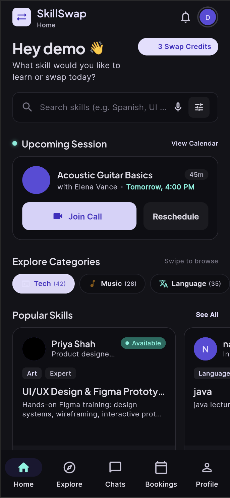
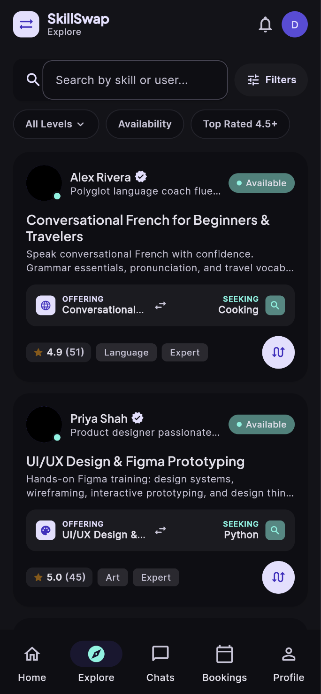

# 🔄 SkillSwap

**A peer-to-peer skill exchange platform built with Flutter & Firebase**

SkillSwap connects learners and teachers in a community-driven marketplace where you can trade skills instead of paying money. Offer what you know, learn what you want — powered by a swap-credit economy.

---

## 📸 Screenshots

<p align="center">
  
  
  
  
</p>

---

## ✨ Features

### 🏠 Dashboard
- Personalized greeting with swap credit balance
- Upcoming session cards with **Join Call** and **Reschedule** actions
- Explore categories carousel (Tech, Music, Language, Art, Fitness, Cooking, Business)
- Popular skills horizontal feed
- Recent chats preview
- Community bonus banner

### 🔍 Explore & Search
- Full-text search across skills and users
- Advanced filter sheet with multi-criteria filtering:
  - **Category** — Technology, Music, Language, Art, Fitness, Cooking, Business
  - **Level** — Beginner, Intermediate, Expert
  - **Availability** — Available, Limited, Unavailable
  - **Rating** — Top Rated 4.5+
- **Bilateral Swap Matrix** on each card showing what a user is _offering_ vs _seeking_
- Verified badges for top-rated teachers (4.5+ avg)

### 📅 Session Booking
- Interactive **TableCalendar** with date selection
- Conflict detection with existing bookings
- Configurable session durations (30 / 60 / 90 / 120 min)
- 8 available time slots per day
- Visual indicators for booked dates
- Booking confirmation flow with validation

### 💬 Real-Time Chat
- Threaded conversations between skill swap partners
- Chat list with last message preview
- Per-session chat context (linked to specific skills)

### 👤 User Profile
- Profile banner with verified badge and **Active Member** status
- Stats bar: Swaps Done · Average Rating · Swap Credits
- **Teaching Portfolio** — skills you offer (add/manage from profile)
- **Skills I Want to Learn** — wishlist for desired skills
- **My Bookings** section with tab-based filtering
- Share profile and edit profile functionality

### ⭐ Ratings & Reviews
- Star-based rating system (1–5) with descriptive labels
- Written review submission after completed sessions
- Ratings feed on user profiles with "Swapped" verification badge
- Trust-building feedback loop within the community

### 🔐 Authentication
- Email/password sign-in and sign-up via **Firebase Auth**
- Demo credentials pre-filled for quick testing
- Auth-guarded routes with automatic redirect

---

## 🏗️ Architecture

```
lib/
├── core/
│   ├── constants/        # App-wide constants, spacing, breakpoints
│   ├── providers/        # Repository providers (Riverpod)
│   ├── router/           # GoRouter configuration with auth guards
│   ├── theme/            # Material 3 theme, AppColors, category themes
│   ├── utils/            # Image utilities, helpers
│   └── widgets/          # Shared widgets (SkillCard, RatingStars, AppShell)
├── data/
│   ├── models/           # Skill, Booking, AppUser, Chat, Rating
│   ├── repositories/     # Abstract repository interfaces
│   ├── firebase/         # Firebase implementations + seed service
│   └── mock_data/        # Mock repositories for offline development
├── features/
│   ├── auth/             # Login, Signup, Splash screens
│   ├── dashboard/        # Home screen with all dashboard sections
│   ├── skills/           # Explore listing + Skill detail screens
│   ├── booking/          # Calendar, confirmation, my bookings
│   ├── chat/             # Chat list + individual chat screens
│   ├── profile/          # Profile view + edit profile
│   └── rating/           # Rating submission screen
├── firebase_options.dart
└── main.dart
```

### Key Design Decisions

| Concern | Choice |
|---------|--------|
| **State Management** | Flutter Riverpod 2.x |
| **Routing** | GoRouter with ShellRoute (bottom nav) + auth redirect |
| **Backend** | Firebase (Auth + Firestore + Storage) |
| **Offline Support** | Mock repositories with realistic seed data |
| **UI System** | Material 3 with custom `AppColors` design tokens |
| **Data Layer** | Repository pattern with Firebase / Mock swap |

---

## 🛠️ Tech Stack

| Layer | Technology |
|-------|-----------|
| Framework | Flutter (Dart SDK ^3.5.0) |
| State Management | `flutter_riverpod` ^2.5.1 |
| Navigation | `go_router` ^14.2.7 |
| Authentication | `firebase_auth` ^5.1.4 |
| Database | `cloud_firestore` ^5.2.1 |
| Storage | `firebase_storage` ^12.4.10 |
| Calendar | `table_calendar` ^3.1.2 |
| Ratings UI | `flutter_rating_bar` ^4.0.1 |
| Typography | `google_fonts` ^6.2.1 |
| Images | `cached_network_image` ^3.4.0 |
| Loading States | `shimmer` ^3.0.0 |
| Date Formatting | `intl` ^0.19.0 |
| Equality | `equatable` ^2.0.5 |

---

## 🚀 Getting Started

### Prerequisites

- Flutter SDK ^3.5.0
- Dart SDK ^3.5.0
- Firebase project (or use mock mode)
- Chrome / iOS Simulator / Android Emulator

### Installation

```bash
# Clone the repository
git clone https://github.com/prasad-bug/SkillSwap-Flutter.git
cd SkillSwap-Flutter

# Install dependencies
flutter pub get

# Run on Chrome
flutter run -d chrome

# Run on iOS Simulator
flutter run -d ios

# Run on Android Emulator
flutter run -d android
```

### Firebase Setup

1. Create a Firebase project at [console.firebase.google.com](https://console.firebase.google.com)
2. Enable **Authentication** (Email/Password provider)
3. Create a **Cloud Firestore** database
4. Run `flutterfire configure` to generate `firebase_options.dart`
5. Deploy security rules: `firebase deploy --only firestore:rules`

### Mock Mode (No Firebase Required)

Set `useMockRepo = true` in `lib/core/constants/app_constants.dart` to run with realistic mock data — no Firebase project needed.

### Demo Credentials

```
Email:    demo@skillswap.com
Password: password123
```

---

## 📂 Firestore Data Model

```
├── users/          # User profiles, skills offered/wanted, ratings
├── skills/         # Skill listings with categories, levels, availability
├── bookings/       # Session bookings with status lifecycle
├── chats/          # Chat threads
│   └── messages/   # Subcollection of individual messages
└── ratings/        # Reviews and star ratings between users
```

---

## 🎨 Design

The UI follows **Material Design 3** principles with a custom deep-purple primary palette:

| Token | Color |
|-------|-------|
| Primary | `#422EC2` |
| Secondary (Teal) | `#006B5F` |
| Tertiary (Amber) | `#6A4200` |
| Surface | `#F8F9FF` |
| Error | `#BA1A1A` |

Supports both **light** and **dark** themes with `ThemeMode.system`.

---

## 📄 License

This project is for educational purposes.

---

<p align="center">
  Built with ❤️ using Flutter & Firebase
</p>
