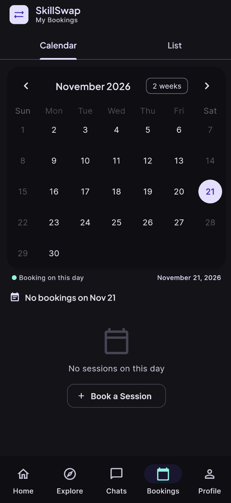

<p align="center">
  
  
  
  
  
</p>

# 🔄 SkillSwap — Peer-to-Peer Skill Exchange Platform

> A full-stack, cross-platform Flutter application where users trade skills instead of money. Offer what you know, learn what you want — powered by a swap-credit economy and real-time Firebase backend.

---

## 🏗️ Architecture

The project follows a **Feature-First Layered Architecture** with clean separation between UI, business logic, and data access:

```
lib/
├── core/                        # Shared foundations
│   ├── constants/               # Spacing, breakpoints, app config
│   ├── providers/               # Riverpod dependency injection
│   ├── router/                  # GoRouter + auth guards + ShellRoute
│   ├── theme/                   # Material 3 tokens, AppColors, extensions
│   ├── utils/                   # Image helpers, formatters
│   └── widgets/                 # SkillCard, RatingStars, AppShell, Skeletons
│
├── data/                        # Data access layer
│   ├── models/                  # Immutable entities (Skill, Booking, AppUser, Chat, Rating)
│   ├── repositories/            # Abstract contracts (interfaces)
│   ├── firebase/                # Firestore + Storage implementations
│   └── mock_data/               # In-memory repos for offline dev
│
└── features/                    # Independent feature modules
    ├── auth/                    # Login · Signup · Splash
    ├── dashboard/               # Home screen sections
    ├── skills/                  # Explore listing · Skill detail
    ├── booking/                 # Calendar · Confirmation · My Bookings
    ├── chat/                    # Chat list · Conversation
    ├── profile/                 # Profile view · Edit profile
    └── rating/                  # Review submission
```

### Design Decisions

| Concern | Approach |
|---------|----------|
| **State Management** | Riverpod 2.x — declarative, testable, compile-safe dependency injection |
| **Navigation** | GoRouter with `ShellRoute` for persistent bottom nav + auth redirect middleware |
| **Backend** | Firebase (Auth + Firestore + Storage) with automatic demo data seeding |
| **Offline Mode** | Swappable mock repositories via a single `useMockRepo` flag — zero Firebase dependency |
| **Data Layer** | Repository pattern with abstract interfaces decoupling UI from data source |
| **UI System** | Custom Material 3 design tokens (`AppColors`) with per-category theme extensions |

---

## 🛠️ Tech Stack

| Layer | Technology | Purpose |
|-------|-----------|---------|
| **Framework** | Flutter 3.5+ / Dart | Cross-platform UI toolkit |
| **State** | `flutter_riverpod` | Reactive state management & dependency injection |
| **Routing** | `go_router` | Declarative URL-based navigation with route guards |
| **Auth** | `firebase_auth` | Email/password authentication with session persistence |
| **Database** | `cloud_firestore` | NoSQL real-time database with reactive streams |
| **Storage** | `firebase_storage` | Profile image uploads |
| **Calendar** | `table_calendar` | Interactive date picker for session scheduling |
| **Ratings** | `flutter_rating_bar` | Star rating input widget |
| **Typography** | `google_fonts` | Custom web font loading |
| **Images** | `cached_network_image` | Cached avatar and skill image loading |
| **Loading** | `shimmer` | Skeleton loading placeholders |
| **Formatting** | `intl` | Date/time internationalization |
| **Equality** | `equatable` | Value equality for immutable model classes |

---

## 📸 App Screens

### 🏠 Dashboard — Home Screen

<p align="center">
  
</p>

The **Dashboard** is the central hub users land on after signing in. It features a personalized greeting with the user's name, a **Swap Credits** balance badge, and a search bar for quick skill discovery. The **Upcoming Session** card highlights the next booked session with teacher details, session time, and one-tap **Join Call** / **Reschedule** actions. Below that, an **Explore Categories** carousel lets users browse skills by domain — Technology, Music, Language, Art, Fitness, Cooking, and Business — each showing the number of available listings. The **Popular Skills** section renders a horizontally scrollable feed of top-rated skill cards with provider info, availability status, category tags, and ratings. The bottom navigation bar provides quick access to all five main sections: Home, Explore, Chats, Bookings, and Profile.

---

### 🔍 Explore — Skill Discovery

<p align="center">
  
</p>

The **Explore** screen is a full-featured skill marketplace with real-time search and multi-criteria filtering. Users can search by skill name or teacher, then refine results using filter chips — **Level** (Beginner, Intermediate, Expert), **Availability** (Available, Limited, Unavailable), and **Top Rated** (4.5+ stars). Each skill card displays the teacher's avatar with a verified badge (for 4.5+ rated users), an availability indicator, and a detailed **Bilateral Swap Matrix** showing what the teacher is _offering_ versus what they are _seeking_ in return — enabling users to find perfect skill-swap matches at a glance. Cards also show star ratings, review counts, category labels, and proficiency level. A dedicated **Filters** bottom sheet allows even deeper filtering with a visual filter-count badge.

---

### 📅 Bookings — Session Calendar

<p align="center">
  
</p>

The **Bookings** screen provides an interactive calendar view of all scheduled sessions. Built with `TableCalendar`, it supports month-by-month navigation with visual indicators for dates that have existing bookings. Users can toggle between a **Calendar** view and a **List** view. Selecting a date shows all sessions for that day, and a **Book a Session** button navigates to the scheduling flow. The booking creation flow includes three steps: (1) select a date from the calendar, (2) choose a session duration (30, 60, 90, or 120 minutes), and (3) pick from 8 available time slots. The system performs conflict detection against existing bookings to prevent double-booking, and routes to a confirmation screen before finalizing.

---

### 👤 Profile — User Dashboard

<p align="center">
  
</p>

The **Profile** screen serves as a comprehensive user dashboard. It opens with a gradient banner showing the user's **Active Member** status, verified badge, avatar, handle (`@username`), and location. A stats bar displays three key metrics: **Swaps Done** (total completed sessions), **Average Rating** (with star icon), and **Swap Credits** (the in-app currency earned by teaching). The **Skills I Teach** section shows the user's teaching portfolio with an **Add Skill** button that opens a modal for creating new skill listings with title, description, category, and level. The **Skills I Want to Learn** wishlist section shows tagged interests. Below that, a **My Bookings** section with tab-based filtering (Upcoming, Completed, Cancelled) gives a quick overview of session history. Users can **Share** their profile link or **Edit** their bio, location, and avatar.

---

## 💡 About the Project

### Problem

Traditional tutoring platforms are expensive and one-directional — you pay money to learn. There's no easy way for people to exchange knowledge directly with each other.

### Solution

**SkillSwap** introduces a **community-driven collaborative learning model** where every user is both a learner and a teacher. Instead of paying for lessons, users earn **Swap Credits** by teaching skills they know, and spend those credits to learn skills they want. The platform handles the entire flow:

1. **Discover** — Browse and search a marketplace of skills across 7 categories
2. **Match** — The bilateral swap matrix shows offering ↔ seeking pairs for optimal matches
3. **Schedule** — Book 1-on-1 sessions with an interactive calendar and time slot picker
4. **Connect** — Communicate via real-time chat threads linked to specific skill sessions
5. **Learn** — Attend sessions with join-call integration
6. **Review** — Rate teachers and leave written feedback to build community trust

### Key Highlights

- **56 Dart source files** · **~15,700 lines of code** · **14 screens** · **7 feature modules**
- **5 Firestore collections** with full CRUD operations and real-time streams
- **Dual backend**: production Firebase and offline mock repos — toggled with a single flag
- **Cross-platform**: runs on Web, Android, and iOS from one codebase
- **Dark & Light theme** with `ThemeMode.system` and full Material 3 compliance

---

## 🚀 Getting Started

### Prerequisites

- Flutter SDK ≥ 3.5.0
- Firebase project (optional — mock mode available)

### Quick Start

```bash
git clone https://github.com/prasad-bug/SkillSwap-Flutter.git
cd SkillSwap-Flutter
flutter pub get
flutter run -d chrome
```

### Firebase Setup (Optional)

1. Create a project at [Firebase Console](https://console.firebase.google.com)
2. Enable **Email/Password** authentication
3. Create a **Cloud Firestore** database
4. Run `flutterfire configure` to generate `firebase_options.dart`
5. Place `google-services.json` (Android) and `GoogleService-Info.plist` (iOS)

### Run Without Firebase

Set `useMockRepo = true` in [`lib/core/constants/app_constants.dart`](lib/core/constants/app_constants.dart) — the app runs fully offline with realistic mock data.

### Demo Credentials

```
Email:    demo@skillswap.com
Password: password123
```

---

<p align="center">
  Built with ❤️ using <strong>Flutter</strong> & <strong>Firebase</strong>
</p>
