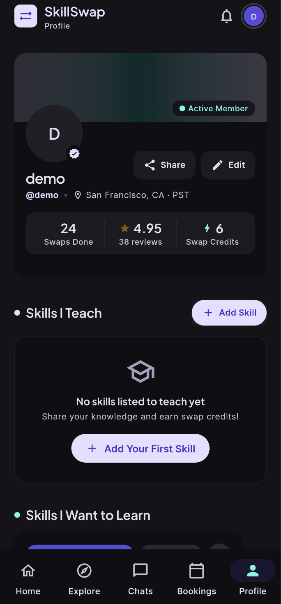

<p align="center">
  
  
  
  
  
</p>

# 🔄 SkillSwap — Peer-to-Peer Skill Exchange Platform

> A full-stack, cross-platform Flutter application where users trade skills instead of money. Offer what you know, learn what you want — powered by a swap-credit economy and real-time Firebase backend.

<p align="center">
  
  &nbsp;&nbsp;
  
  &nbsp;&nbsp;
  
  &nbsp;&nbsp;
  
</p>

---

## 💡 Problem Statement

Traditional tutoring platforms are expensive and one-directional. **SkillSwap** introduces a **community-driven collaborative model** where every user is both a learner and a teacher — scheduling 1-on-1 sessions, communicating in real-time, and building peer trust through verified ratings.

---

## ✨ Key Features

| Feature | Description |
|---------|-------------|
| 🔐 **Authentication** | Email/password auth via Firebase Auth with persistent sessions & route guards |
| 🏠 **Smart Dashboard** | Personalized greeting, upcoming session alerts, category browser, trending skills carousel |
| 🔍 **Skill Discovery** | Full-text search with debounced input, multi-criteria filtering (category, level, availability, rating) |
| 🔄 **Swap Matrix** | Each skill card shows what the user offers vs. what they seek — enabling bilateral matching |
| 📅 **Session Booking** | Interactive calendar (TableCalendar), 8 time slots, 4 duration options, conflict detection |
| 💬 **Real-Time Chat** | Firestore-powered reactive messaging threads linked to specific skill sessions |
| ⭐ **Ratings & Reviews** | Star-based rating (1–5) with written reviews; verified "Swapped" badges for trust |
| 👤 **Rich Profiles** | Teaching portfolio, learning wishlist, stats dashboard (swaps, rating, credits), share & edit |
| 🌗 **Dark/Light Theme** | Full Material 3 theming with `ThemeMode.system` support |
| 📱 **Cross-Platform** | Runs on Web, Android, and iOS from a single codebase |

---

## 🏗️ Architecture

The project follows a **Feature-First Layered Architecture** with clean separation of concerns:

```
lib/
├── core/                        # Shared foundations
│   ├── constants/               # Spacing, breakpoints, app config
│   ├── providers/               # Riverpod dependency injection
│   ├── router/                  # GoRouter + auth guards + ShellRoute
│   ├── theme/                   # Material 3 tokens, AppColors, extensions
│   ├── utils/                   # Image helpers, formatters
│   └── widgets/                 # SkillCard, RatingStars, AppShell, Skeletons
│
├── data/                        # Data access layer
│   ├── models/                  # Immutable entities (Skill, Booking, AppUser, Chat, Rating)
│   ├── repositories/            # Abstract contracts (interfaces)
│   ├── firebase/                # Firestore + Storage implementations
│   └── mock_data/               # In-memory repos for offline dev
│
└── features/                    # Independent feature modules
    ├── auth/                    # Login · Signup · Splash
    ├── dashboard/               # Home screen sections
    ├── skills/                  # Explore listing · Skill detail
    ├── booking/                 # Calendar · Confirmation · My Bookings
    ├── chat/                    # Chat list · Conversation
    ├── profile/                 # Profile view · Edit profile
    └── rating/                  # Review submission
```

### Design Decisions

| Concern | Approach |
|---------|----------|
| **State Management** | Riverpod 2.x — declarative, testable, compile-safe DI |
| **Navigation** | GoRouter with `ShellRoute` for bottom nav + auth redirect middleware |
| **Backend** | Firebase (Auth + Firestore + Storage) with automatic Firestore seeding |
| **Offline Mode** | Swappable mock repositories via `useMockRepo` flag — zero Firebase dependency |
| **Data Layer** | Repository pattern with abstract interfaces decoupling UI from data source |
| **UI System** | Custom Material 3 design tokens (`AppColors`) with per-category theme extensions |

---

## 🛠️ Tech Stack

| Layer | Technology | Purpose |
|-------|-----------|---------|
| **Framework** | Flutter 3.5+ / Dart | Cross-platform UI |
| **State** | `flutter_riverpod` | Reactive state management & DI |
| **Routing** | `go_router` | Declarative URL-based navigation |
| **Auth** | `firebase_auth` | Email/password authentication |
| **Database** | `cloud_firestore` | NoSQL real-time database |
| **Storage** | `firebase_storage` | Profile image uploads |
| **Calendar** | `table_calendar` | Interactive date picker |
| **Ratings** | `flutter_rating_bar` | Star rating input widget |
| **Typography** | `google_fonts` | Custom font loading |
| **Images** | `cached_network_image` | Cached avatar/image loading |
| **Loading** | `shimmer` | Skeleton loading placeholders |
| **Formatting** | `intl` | Date/time internationalization |
| **Equality** | `equatable` | Value equality for models |

---

## 📂 Database Schema (Cloud Firestore)

```
firestore/
├── users/{userId}               # name, email, bio, location, skillsOffered, skillsLearning, rating
├── skills/{skillId}             # title, description, category, level, availability, ownerId, rating
├── bookings/{bookingId}         # skillId, teacherId, learnerId, dateTime, duration, status
├── chats/{chatId}               # participants, lastMessage, timestamp
│   └── messages/{messageId}     # senderId, text, timestamp
└── ratings/{ratingId}           # bookingId, fromUserId, toUserId, stars, review, skillTitle
```

---

## 🚀 Getting Started

### Prerequisites

- Flutter SDK ≥ 3.5.0
- Firebase project (optional — mock mode available)

### Quick Start

```bash
# Clone
git clone https://github.com/prasad-bug/SkillSwap-Flutter.git
cd SkillSwap-Flutter

# Install dependencies
flutter pub get

# Run (Chrome)
flutter run -d chrome

# Run (iOS / Android)
flutter run
```

### Firebase Setup (Optional)

1. Create a project at [Firebase Console](https://console.firebase.google.com)
2. Enable **Email/Password** authentication
3. Create a **Cloud Firestore** database
4. Run `flutterfire configure` to generate `firebase_options.dart`
5. Place `google-services.json` (Android) and `GoogleService-Info.plist` (iOS)
6. The app auto-seeds demo data on first launch

### Run Without Firebase

Set `useMockRepo = true` in [`lib/core/constants/app_constants.dart`](lib/core/constants/app_constants.dart) — the app runs fully offline with realistic mock data.

### Demo Credentials

```
Email:    demo@skillswap.com
Password: password123
```

---

## 📊 Project Stats

| Metric | Value |
|--------|-------|
| Dart source files | 56 |
| Lines of code | ~15,700 |
| Feature modules | 7 |
| Data models | 5 |
| Screens | 14 |
| Firebase collections | 5 |

---

## 📄 License

This project is for educational and portfolio purposes.

---

<p align="center">
  Built with ❤️ using <strong>Flutter</strong> & <strong>Firebase</strong>
</p>
